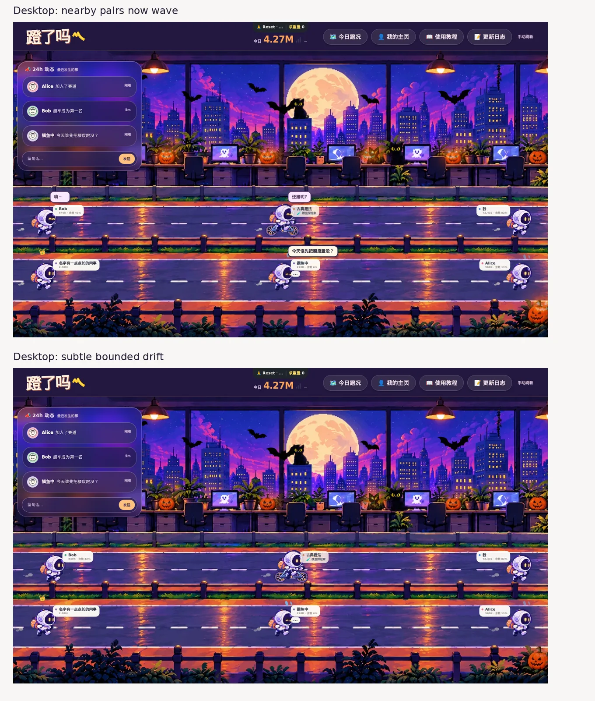

# 蹬了吗 · 动画系统总账与变更规范

> **动画盘点的唯一入口（2026-10-20）**。范围：网页首页的赛道/办公室人物、两种布局、交互气泡、万圣节特效，以及同一页面直接相关的求重置/徽章微动效。不是全站其他页面的动画清单。
>
> **状态**：本文件记录的是当前 `main` 真实行为，**不是全部已实现的新架构**。改造计划见 [双布局与气泡技术方案](denglema-scene-motion-layout-design.md)；美术/Sprite 导出由其他 Session 管理。
>
> **维护原则**：修改任何动画触发器、CSS keyframe、展示状态或时序，先更新本总账，再运行 `node --test test/animation-inventory.test.js`。本页末尾的清单由测试与代码双向比对，防止再次漏掉自动漂移或新增动作。

## 1. 一个总管，五类职责

| 职责 | 唯一负责什么 | 当前实现入口 | 不应该负责什么 |
| --- | --- | --- | --- |
| **Layout** | 四车道/双道路布局、持久坐标投影、初始/手动站位 | `lanePlan`, `positionPlan`, `pointerOfficePosition`, `renderRiders` | 不触发剧情动作、不修改 Sprite |
| **Locomotion** | 人物**真实屏幕位置**的临时自动移动、碰撞与动线 | `scheduleAmbientDrift`, `hasHardOfficeCollision`, `.rider {transition:left}` | 不把漂移写回 `office_position`、不切换道路 |
| **Action Director / Presenter** | 选择做什么、动作互斥、播放表现及结束清理 | `scheduleDirector`, `chooseMotion`, `triggerMotion`, `MOTION_ACTIONS`, CSS `is-*` | `sprint` 等局部姿态不应默默修改全局 X |
| **Interaction / Bubble** | 相邻人物社交、动作气泡、留言展示/置顶、全局避让（未来） | `nearbyRiderPairs`, `triggerNearbyWave`, `showRiderMessage`, `syncRiderCommentBubbles` | 气泡位置不应反向改变人物布局 |
| **Ambient / Theme / UI** | 轮子、步态、情绪、装饰与季节光影 | `styles.css`, `halloween-theme.css`, `theme-runtime.js`, Manifest | 不触摸人物保存坐标、不截断点击 |

这些是**设计职责/管理口径**，现在仍有代码混在 `public/app.js` / `public/styles.css`；不要误写成已经抽出五个模块。后续模块化时要保持本表语义。

## 2. 时钟与调度：必须全盘保留

| 机制 | 当前触发 / 周期 | 改变什么 | 跳过/停止规则 | 所有者 |
| --- | --- | --- | --- | --- |
| **初始排位** | `renderRiders()`；首次和重载 | 选择 visible lane 与基准 `x`；稳定 hash + 间距 | 手动位置优先；万圣节逻辑 1/2→视觉 1，3/4→视觉 3 | Layout |
| **Ambient Drift 自动漂移** | `setInterval` 每 **4200ms** | 尝试 X 增量 `[-0.7,+0.7]` 百分点；累计偏移 `[-2.2,+2.2]`；最终限制 `22–78%`，通过 `left` 过渡 | 动作中、本人拖动中跳过；同可见 lane 小于 `7.5` 百分点碰撞即取消；无 API 保存 | Locomotion |
| **位置过渡** | `.rider { transition:left 6.4s cubic-bezier(...) }` | DOM 的实际屏幕 X | 普通四车道仍沿用 4.2s 尝试；万圣节增加冷却/随机停顿，防止过渡追逐 | Locomotion |
| **Director** | 单次 `setTimeout` 延迟 **2600–5200ms**，运行后重新安排 | 从可用骑手选动作，不直接存储位置 | 没人则空轮询；`activeMotion` 禁止重入，拖动时 `triggerMotion` 拒绝 | Action |
| **双人招手** | Director 有多人时，概率 **34%** 先尝试 | 同显示 lane 且 `x` 相距 **≤22** 百分点，触发两人 `wave`、互动文字 | 不跨 lane；当前邻近判断基于 `visibleRiders.x`，**不是漂移后的视觉位置** | Interaction |
| **动作终结** | 仅由 `MOTION_ACTIONS[].duration` 的 JS timeout 终结，CSS keyframe 只负责视觉 | 清除 `is-*`、气泡表演 props 与 `activeMotion` | `finish()` 幂等，避免重复清理 | Action |
| **实时数据** | **20000ms** | 重读 riders、events，可能触发布局/留言变化 | 拖动中跳过 riders reload；隐藏页面不刷新 | Runtime |
| **最近留言** | 新留言被自动展示后 **7000ms** 隐藏 | 人物旁的 `.rider-message-bubble` | 用户置顶时不会被自动超时关闭；只有一个 pinned rider | Bubble |
| **季节灯光** | CSS **4.1s** `halloweenPumpkinBreath` | Glow 层 `opacity: .10→1`，`screen` 混合 | `prefers-reduced-motion` 固定 `.55` | Theme |
| **求重置交互** | 点击 `resetBegButton` | `begBounce` 0.48s，提交成功后 9 个随机 emoji 粒子飞散约 820ms；1s 删除粒子层 | reduced-motion 不创建粒子；点击期间按钮禁用 | UI |

**重要区分**：`Locomotion` 是屏幕上位置变化，`Action` 是角色局部姿势/步态，`Interaction` 是两个骑手之间的事件；三者同屏并存但各自拥有状态。**不能只盘点 `MOTION_ACTIONS` 就宣称动画系统完整**。

**当前已知技术债**：普通四车道仍用旧 4.2s 漂移/百分比间距；万圣节已加入物理占位检查与 9s 冷却；双人招手仍按记录的 X 判邻近；隐藏页面虽停调度，但已开始的部分 CSS 动效仅通过 `.is-background-paused` 显式暂停，不保证所有动效都暂停。待布局工程处理，不能把计划写成现状。

## 3. Actor 状态与动作字典

`MOTION_ACTIONS` 的代码真相在 `public/app.js`；下表覆盖**全部 10 个动作**。动作选择可能由 `quotaPressure`、personality 及随机抽签影响，不等同于单纯均匀概率。

| 动作 ID | DOM 类 | 标称持续 | 说明/作用 |
| --- | --- | --- | --- |
| `wave` | `is-waving` | 3200ms | 打招呼；可由邻近互动双人触发 |
| `sip` | `is-sipping` | 3400ms | 喝水/咖啡/奶茶，道具出现 |
| `stretch` | `is-stretching` | 3300ms | 伸展姿势 |
| `yawn` | `is-yawning` | 3500ms | 哈欠/困困 |
| `coast` | `is-coasting` | 3800ms | 局部滑行表现、轮子/腿可停；**不是自动漂移的别名** |
| `sprint` | `is-sprinting` | 1800ms | 冲一小段的夸张动作；小概率附带火焰 |
| `quotaRush` | `is-quota-rushing` | 1650ms | 额度焦虑状态下动作 |
| `wheelie` | `is-wheelie` | 1800ms | 不同 transport 表现不同：翘车、踉跄、跳板等 |
| `bonk` | `is-bonking` | 2200ms | 撞墙式疲惫、掉速的趣味表现 |
| `celebrate` | `is-celebrating` | 1900ms | 小幅庆祝动作 |

**动作时间合同（2026-10-21 合并前分支）**：`wave` JS 生命期 3200ms，而 `socialSway` CSS 仍只有 1.5s；现已改为仅 JS `action.duration` 控制动作结束，CSS `animationend` 不会提前终结。修改 CSS 动画长度不等于修改 Director 生命周期。

额外持久/派生态：`is-chill`, `is-tired`, `is-quota-hurry/panic`, `quota-emotion-sweat/gloom/sleepy`, transport mode `bike/scooter/skateboard/walk/surf/skate`, 头像配饰、皇冠和称号。它们可能改变步态、表情与特效，但**不是第 11 种 Director 动作**。

## 4. 视觉层索引（不等同于额外的人物移动）

| 家族 | 关键帧 / CSS 入口 | 触发 / 当前状态 |
| --- | --- | --- |
| 普通背景 | `trackFlow` | 在 `.track-motion` 定义；当前视觉整理 CSS 隐藏相关 DOM（保留兼容代码） |
| 骑手基本状态 | `riderBob`, `tiredWobble`, `quotaGloomPulse`, `quotaSleepFloat` | 持续蹬动/疲惫/配额情绪 |
| Action 主动姿态 | `sprintSurge`, `wheeliePop`, `bonkSag`, `victoryHop`, `socialSway`, `sipPause`, `stretchPause`, `yawnPause`, `coastGlide` | `triggerMotion` 加类；后续 CSS Presenter 可以由 Pixel Sprite 替代 |
| Action 身体细节 | `friendlyWave`, `sleepyNod`, `socialPropPop` | 摆手、低头、道具弹出 |
| 交通工具与腿 | `wheelSpin`, `pedalLeg`, `bikeWheelie`, `bikeClunk`, `bikeBounce`, `scooterWobble`, `tinyOllie`, `walkHop`, `surfSplash`, `skateTwirl`, `scooterKick`, `skateboardPush`, `walkStride`, `skateGlide` | 各 transport 使用不同 CSS；自行车踩踏、滑板脚推、徒步迈步等不应全部被统一骑行覆盖 |
| 附加粒子/状态 | `speedFlicker`, `flameFlicker`, `dustPop`, `sweatPop`, `musicFloat`, `comicBubblePop` | 冲刺、尘土、配额汗滴、音乐、趣味/留言气泡 |
| 页面/徽章装饰 | `miniRide`, `achievementSparkA`, `achievementSparkB`, `begBounce`, `begParticleFlight` | 登录 mini-bike、徽章闪烁（后续样式可能隐藏）、求重置按钮与粒子 |
| 代码保留未使用 | `sprintJolt`, `burstPop`, `crownBob` | **CSS 有定义，但在当前 `styles.css` 未找到动画调用**；不要误报为正在播放 |
| 万圣节当前播放 | `halloweenPumpkinBreath` | `public/halloween-theme.css` + `manifest.json` 中 `pumpkin-glow` |
| 万圣节已定义但停用 | `halloweenBatFly` | CSS 和 `theme-runtime.js` 支持，但 Manifest 的 `flyovers: []`；猫与蝙蝠目前**静态** |

交互补充：`rider-message-bubble` 是独立留言展示状态，当前仍位于 Rider DOM 内、`max-width:220px`，靠 `is-near-right` 翻转；`effect-burst` 是动作短语，二者会一起影响视觉占位。普通 tooltip、hover/transition 也不计为 Director 动作。

## 5. 生命周期与冲突仲裁

```text
Layout   ──→ Rider 世界坐标 / 脚底锚点
                   │
Locomotion ──→ 临时屏幕位移（仅道路内）
                   │
Director ─────→ Action / 表情 / 交通工具 Sprite
                   │
Interaction ──→ 留言 / 招手事件
                   │
Bubble Overlay ──→ 仅显示并避让，不反向推动 Rider
Theme Ambient ────→ 背景 Glow / 静态小猫蝙蝠
```

**优先级（目标设计）**：用户主动拖动 > 用户主动查看/置顶留言 > 当前动作 > ambient drift。这里的停漂移规则是新方案，**当前实现只检查 activeMotion/拖动**。

**单一写入者**：
- `office_position` 只有显式拖拽成功后才写服务端（`expected_layout_version` 与 409 rollback 保留）。
- 屏幕位移由 Layout/Locomotion 写，`MotionPresenter` 仅处理 Rider 内部元素/帧与姿势，不通过额外 `style.left` 重排。
- Bubble 所有者统一测量和绘制；避免每人单独摆一张 220px 气泡造成碰撞。
- `main` 四车道与万圣节双道路是两个展示布局；映射 `1,2→upper`、`3,4→lower`，**绝不加第三条路**。

**暂停/回收**：
- hidden 页 `stopRaceRuntime` 停止 Director、Drift、数据刷新；返回前台加载数据后重新启动。
- `activeMotion` 是动作互斥锁，`triggerMotion` 结束、用户离开时清理；不能在动态替换 Sprite 时遗留锁。
- `prefers-reduced-motion` 禁用大部分 CSS 帧动画与蝙蝠移动、保留半亮南瓜；新的 Locomotion 必须明确在此模式停止漂移。
- 拖拽中获取舞台 pointer capture，跨道变更父 DOM 时不能丢失；Bubble/Glow `pointer-events:none`。

## 6. 开发/Review 变更检查（必须）

每次修改 `public/app.js` 中动作函数、`public/styles.css`、`public/halloween-theme.css`、`theme-runtime.js` 或季节 Manifest：

1. **先分类**：Layout（位置）、Locomotion（自动移动）、Director（动作）、Interaction/Bubble（社交）、Theme/UI（装饰）；如果一个改动跨两类，说明谁是坐标写入者。
2. **更新总账**：涉及的新动作补 `MOTION_ACTIONS` 表；CSS 新 `@keyframes` 补下方清单和「当前启用/未启用」状态；不是所有动画都在 `MOTION_ACTIONS`。
3. **检查交互组合**：自动漂移 × 跨道拖动；Director × 近期留言；持续蹬车 × 临时动作；人物缩放 × hitbox；气泡 × event rail；普通四车道 × 万圣节双道路。
4. **完整时序**：定时周期、动作统一 JS 生命周期与场景漂移冷却、恢复/卸载/标签页隐藏；不要产生隐藏定时器或持续无效 reflow。
5. **降级测试**：`?preview=1&motion=wave`（其他动作也可）、`?season=halloween`、`?season=off`、375px 和桌面、DPR、多人/零 token、`prefers-reduced-motion`，并确保静态猫蝙蝠/Glow 不覆盖拖动。
6. **保持边界**：这里不修改 Usage、server 用户数据或美术文件；未来 Sprite 资源会话提供帧宽高、脚底锚点、FPS，本会话负责 Runtime。
7. **执行 `node --test test/animation-inventory.test.js`**，通过后再执行 `npm test`；此静态测试只检查盘点完整性，**不能代替浏览器视觉验收**。

## 7. 可核对的关键帧 / Action 目录

以下清单是对目前两个 CSS 文件全部 `@keyframes`（分别 **45** 与 **2**）及目前 `MOTION_ACTIONS`（**10** 个）的**机械索引**。包含已定义但未运行的项；测试会比对两边集合，不允许新增/删除却忘记更新本页。Runtime Hooks 用于守护设计的已知入口（不能据此声称未来新增的 JS 动画也会被自动发现）。

<!-- animation-catalog:start -->
```json
{
  "motionActions": [
    "wave",
    "sip",
    "stretch",
    "yawn",
    "coast",
    "sprint",
    "quotaRush",
    "wheelie",
    "bonk",
    "celebrate"
  ],
  "runtimeHooks": [
    "lanePlan",
    "positionPlan",
    "renderRiders",
    "pointerOfficePosition",
    "attachOwnRiderDrag",
    "scheduleAmbientDrift",
    "nearbyRiderPairs",
    "triggerNearbyWave",
    "scheduleDirector",
    "chooseMotion",
    "triggerMotion",
    "startRaceRuntime",
    "stopRaceRuntime",
    "showRiderMessage",
    "closeRiderMessage",
    "syncRiderCommentBubbles",
    "burstBegParticles",
    "begForReset"
  ],
  "keyframes": {
    "public/styles.css": [
      "trackFlow",
      "riderBob",
      "sprintSurge",
      "wheeliePop",
      "bonkSag",
      "victoryHop",
      "sprintJolt",
      "tiredWobble",
      "bikeWheelie",
      "bikeClunk",
      "bikeBounce",
      "wheelSpin",
      "pedalLeg",
      "speedFlicker",
      "flameFlicker",
      "dustPop",
      "sweatPop",
      "musicFloat",
      "comicBubblePop",
      "burstPop",
      "miniRide",
      "crownBob",
      "socialSway",
      "sipPause",
      "stretchPause",
      "yawnPause",
      "coastGlide",
      "friendlyWave",
      "sleepyNod",
      "socialPropPop",
      "scooterWobble",
      "tinyOllie",
      "walkHop",
      "surfSplash",
      "skateTwirl",
      "begBounce",
      "begParticleFlight",
      "achievementSparkA",
      "achievementSparkB",
      "quotaGloomPulse",
      "quotaSleepFloat",
      "scooterKick",
      "skateboardPush",
      "walkStride",
      "skateGlide"
    ],
    "public/halloween-theme.css": [
      "halloweenPumpkinBreath",
      "halloweenBatFly"
    ]
  }
}
```
<!-- animation-catalog:end -->

## 8. 2026-10-22 全宽站位后的自动移动与社交修复

**背景**：#79 将万圣节视觉道路扩展到全宽，但旧 `nearbyRiderPairs()` 仍要求同道路相邻者 X 距离 `<=22%`。五人同路时均匀间距约 `22.2%`，三人同路时更远，造成双人招手实际上无法触发。另一方面 `renderRiders()` 每次收到新的 usage（默认每 20s）都会清除 `style.left` / `data-drift`，导致自动漂移反复回原位。

**本轮修复（单独行为补丁，无额外美术需求）**：

- 新 `public/scene-motion.js` 中的 `adjacentSameRoadPairs()`：按**当前实际画面 X 排序**寻找同一道路左右相邻人物，不再套用旧的 22% 上限；仍然禁止跨道路组合，并跳过已有动作中的骑手。原有 Director `2.6–5.2s` 调度及 `34%` 社交尝试概率不变。
- `nextAmbientOffset()`：以道路像素宽度决定一次约 16–32px（桌面）的小幅移动，在 ±48px / 道路宽度 4.5% 范围内游走；复用旧的 4.2s 尝试、45% 随机停顿、9s 冷却、人物实际矩形碰撞、拖动/hover/留言优先级，不发生跨路运动。窄路会自动缩小位移或因拥挤取消动作。
- 首页使用 `data-scene-layout-key` 比较 rider 所在 lane、布局 X 与 scale：**usage 刷新但坐标契约没变时保留漂移**；人数改变、用户手动修改位置等导致场景布局确实改变时才复位临时偏移。
- 人物随机姿势/表情仍由原 `MOTION_ACTIONS` 与当前 PNG Frame Presenter 负责；`scene-motion.js` 不修改 Sprite 帧或美术素材，不能把“能配对招手”误称为每一种车都有专门的招手精灵帧。



**测试与可视验收**：`node --test test/scene-motion.test.js` 覆盖五人全宽邻居、同路配对、边界漂移与数据刷新接线；`npm test` 全量 **129/129**。隔离 Chromium Preview 中控制随机序列，确认两个上路 Rider 同时进入 `is-waving`，Overlay 同时显示“嗨～ / 还蹬呢?”；另一组检查 6.8s 与约 22s 时的 `data-drift`：前者偏移约 1.94%，后者偏移延续至约 3.14%，没有因周期性预览刷新归零。此为隔离预览，不等于已部署生产环境。

