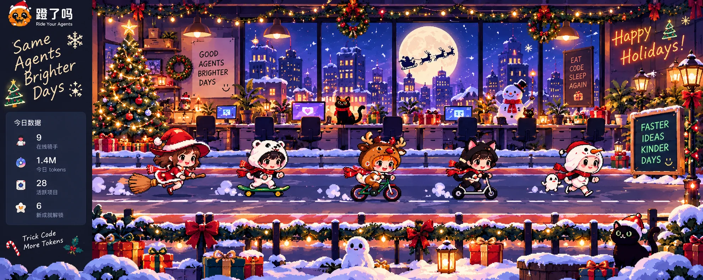

# 蹬了吗 · 圣诞节办公室（未来主题概念存档）

> 状态：**设计参考，暂不开发、暂不上线。** 本轮正式交付目标仍是万圣节主题。2026-10-19 用户明确纠正了圣诞节开发指令，要求保留概念稿供未来使用。

## 设计方向

- 延续万圣节主题的像素插画风、办公室夜景和双赛道场景，改为冷蓝雪夜与暖金灯光。
- 参考画面包括：窗外雪城、月亮、圣诞树、彩灯、雪地、礼物、壁炉与节日标语；不是让真实前端复刻图里的示例 UI。
- 动效方向：单独的雪花层、彩灯呼吸、窗外圣诞老人剪影；使用统一主题 Manifest 与素材坐标画布。
- **重要限制**：这张概念图包含虚构的骑手、部分 UI 和文字，**不能直接用作生产背景**。未来必须单独生成不含人物和 UI 的场景底图，骑手继续使用真实数据 DOM。
- 未来按已锁定的万圣节标准制作分层素材：基底、glow、前景、粒子/飞行 Sprite；统一设计画布 3840×1440，真实原生细节不可由简单放大冒充。
- 这张原稿约 1983×793，仓库保存约 381 KB WebP 参考副本，不代表高清生产母图。

## 暂停的实现

以前尝试的 `feat/denglema-christmas-theme-system` 是**未完成的实验分支**，不要合并或发布；其背景未满足无人物/无 UI 的生产分层要求。未来重新开发时，应从届时最新 `main` 新建分支，复用已经完成的万圣节主题引擎，不直接复活旧的圣诞分支。

## 万圣节仍为当前目标

继续以 [万圣节分层设计基线](denglema-halloween-layered-theme-design.md) 和 [万圣节 v2 资产说明](denglema-halloween-layered-v2.md) 为准。先核查已部署的动画、高清导出和交互，再按剩余差距补完；不要将圣诞功能混入正在交付的万圣节版本。
