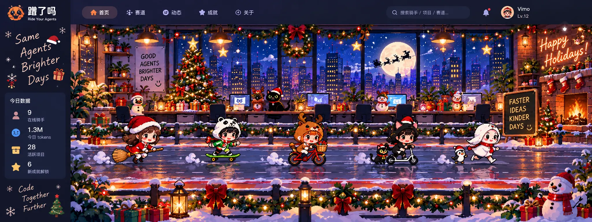

# 蹬了吗 · 圣诞节主题视觉概念（归档，未开发）

> 状态：**仅归档参考图；不创建圣诞节运行时资源、不修改前端、不部署主题**。2026-10-19 用户明确要求优先完成万圣节主题，圣诞节留作以后开发。

## 后续开发时参考

- 延续现有万圣节 **双赛道、办公室 + 城市夜景、明亮像素插画** 的整体视觉语言，保留现有 UI、身份、拖动、usage 和骑手渲染。
- 圣诞元素包括城市飘雪、圣诞树、彩灯、花环、雪人、礼物、雪地路面；图中已画入的骑手、菜单、统计数据都是**概念图的一部分**，不能直接作为生产背景。
- 继续复用 `docs/denglema-halloween-layered-theme-design.md` 中的分层资产与 3840×1440 设计母版合同：先制作独立无人物主背景，再分别准备发光、前景与粒子图层。
- 本文件仅保存风格，不意味着圣诞主题已经实现、经过视觉验收或具有计划上线日期；若日后开工需另设 PR。
