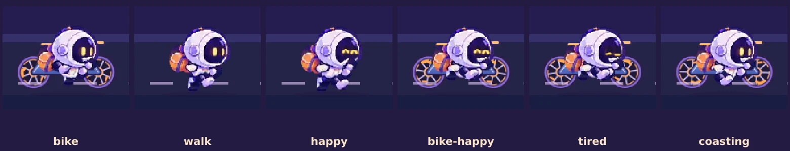
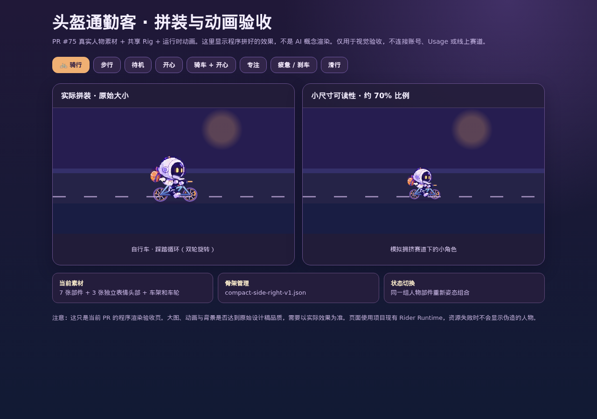
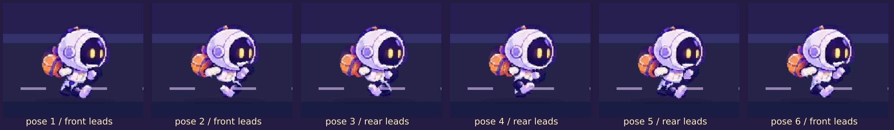

# 蹬了吗 · 头盔通勤客 v0.1

> **唯一确认的视觉基线**：用户提供的《抽象人物预设方向》六角色设计图中的 **1 号头盔通勤客**。设计稿是人物外观的美术基准，**不是可直接裁剪成独立组件的制作图集**。目前实际部件为根据该设计稿提取和处理的透明像素图；尚待浏览器中的视觉验收，不能声称已完全还原。
>
> **产品范围**：默认人物、固定右向侧视、Head/Body/Backpack 三个换装槽、基础表情、步行与自行车。其他人物和载具后续再逐一制作；背景跑道、落点、权限、拖动、Usage 和留言不属于本 PR。

## 1. 视觉不可偏移项

- 圆润的大奶油白头盔、淡紫阴影、深紫黑色面罩、暖黄色发光眼睛、橙色小背包，身体和四肢短小可爱，**无性别特征**。
- 默认造型不包含万圣节头饰；保留像素插画的柔和体积光和轮廓，不退回粗糙的几何 SVG 小人或 Emoji 面孔。
- 只有向右的侧视角，人物和自行车独立于背景主题。舞台依素材保持双道路（万圣节）与普通主题旧车道行为。

## 2. 素材管理职责（2026-10-21 修订）

**规则：源部件独立、Manifest 声明引用、Rig 声明锚点；不要手写贴图坐标。**

```text
public/riders/
├── manifest.json                   # 默认 preset / 已启用载具
├── rigs/
│   └── compact-side-right-v1.json  # 共用坐标系、部件摆放、关节 pivot、自行车锚点
└── presets/helmet-commuter/
    ├── manifest.json               # 仅列素材路径 + 动画定义 + rig 引用
    ├── head.webp                   # 默认圆眼头盔
    ├── head-happy.webp             # 独立开心头盔（弯眼）
    ├── head-focused.webp           # 独立专注头盔
    ├── head-tired.webp             # 独立疲惫头盔
    ├── body.webp                   # 身体
    ├── backpack.webp               # 橙色背包
    ├── arm_back.webp
    ├── arm_front.webp
    ├── leg_back.webp
    ├── leg_front.webp
    ├── bike-frame.svg              # 无车轮的车架
    └── bike-wheel.svg              # 可独立旋转的车轮素材
```

### 谁管理什么

| 职责 | 所属文件 | 可以人工维护吗？ |
| --- | --- | --- |
| 有哪些人物、默认人物、启用的载具 | 全局 `manifest.json` | 是 |
| 每个预设选择什么 head/body/backpack，使用哪个 rig | preset `manifest.json` | 是 |
| 部件位置、画布尺寸、pivot、坐姿与轮/手/脚锚点 | 共享 `rig.json` | 是，属骨架设计，不与贴图打包位置耦合 |
| 图片里某个部件裁剪于哪块区域 | **不在运行时 Manifest** | 否，需要时由素材构建工具生成 |
| 像素资源本身 | 独立透明 `.webp` | 美术原始资源可换，保留统一朝向与锚点 |
| 动画姿态与渲染 | `public/rider-runtime.js` | 是 |

当前初版只有一个角色和一种正式载具，不必提前引入复杂通用图集打包器。人物增加后，按相同 Rig 规格导出各部件即可。**如果未来发现独立资源请求太多，再构建期自动打包 atlas + 元数据**；二者都应是生成文件，不把裁剪坐标当人手写的产品合同。

## 3. 模块拼装

- 共用 128×100 逻辑画布。默认 preset 指向 `/riders/rigs/compact-side-right-v1.json`。
- 视觉顺序：地面阴影 → **独立前后轮** → 自行车车架 → 后腿 → 背包 → 后手臂 → 身体 → 前腿 → **当前状态的完整头部素材** → 前手臂。表情直接换完整头盔，运行时不在面罩上临时画两条线。
- 更换 Head、Body、Backpack 时只换图片路径；不修改摆放坐标、骑行锚点和其它部件切图区域。
- 逻辑动画：`idle` 4、`walk` **6 段落脚姿态**、`happy` 3、`focused` 3、`tired` 3；`bike_mount` 2、`bike_ride` 6、`bike_glide` 2、`bike_brake` 2。
- 步行脚掌通过离散关键姿态保持着地，不再用整条腿大角度旋转；骑车脚掌目标点与曲柄围绕同一中心作前后 180° 相位差运动。车轮跟随速度连续旋转，滑行继续滚动，刹车减速；以上关节 / 车轴锚点属于共享 `rig.json`。
- 这里的帧是基于相同独立部件的 rig 姿态；**不是已经逐帧精绘的 6 张骑行 PNG**。待实际画面确认后再做更精细的动作图。

## 4. 资源清理与防止混淆

- 已删除旧手绘 `head.svg / body.svg / backpack.svg` 和被否决的工程版人物设计板。
- 已删除临时手写裁剪坐标的 `atlas.webp`；原图集仅用于一次性提取独立部件，当前页面不会再请求它。
- **Manifest v2 没有 `crop`、`atlas`、贴图 `x/y`**。共享骨架可以有摆放锚点，但不得在这里输入像素图集切片坐标。
- 已确认的完整六角色设计稿目前仍是对话附件；后续如正式归档，需存储其原件并标注「概念参考」，不要拿其中的画面直接切出新的换装套装作为生产素材。

## 5. 最低验收

1. CI `npm test`、`node --check` 通过；七张部件 WebP + 三种额外表情头部 + `bike-frame.svg` / `bike-wheel.svg` 均能独立加载，旧 `atlas.webp`、`bike.svg` 和旧占位 SVG URL 是 404。
2. 头盔、手臂、背包在 1440/375px 不错位；背景仍保持已有双道路和普通版本旧车道。
3. 待机、步行、骑行、滑行、刹车、开心/专注/疲惫动画不破坏轮胎/手脚对位，尊重 reduced-motion。
4. 自己人物拖动、留言气泡、设备绑定、使用量不受影响。
5. **完成真实浏览器截图视觉验收前，不直接合并 PR #75**。

## 6. 动画预览（PR #75）

在隔离预览环境打开 `/rider-preview`，可切换骑行、滑行、刹车、步行、开心、**骑车时开心**、专注和疲惫。该页面调用与首页相同的 `rider-runtime.js` 和 Manifest，是程序拼装结果，不是新生成的概念图。验证需记录实际浏览器截屏及车轮角度变化，并确认小尺寸可读性。


## 7. 2026-10-21 动画纠偏与浏览器验收

本轮在原 PR #75 上修复用户指出的三类视觉问题：

- **完整头部表情素材**：`head-happy.webp`、`head-focused.webp`、`head-tired.webp`，结合默认 `head.webp`，切换状态时直接更换完整头像，不用运行时覆盖面罩。与帽身/背包槽保持解耦。
- **脚掌与踏板**：步行使用共享 Rig 中六段落脚关键姿态（限制大角度旋转、保持着地帧）；骑车利用 `crank.center / crank.radius` 计算前后相差 180° 的脚踏目标，脚部跟随脚踏移动。
- **前后车轮独立旋转**：`bike-frame.svg` + `bike-wheel.svg` 分层渲染。骑车加速、滑行保持滚动、刹车衰减转速。旧静态 `bike.svg` 已移除。
- **换装边界**：单一 head override 在表情切换时仍保留；提供多表情资源的预设可按状态选择新头部，不回退到默认角色头盔。

浏览器真实渲染（**不是 AI 概念图**）：



验收记录：Chromium headless 在独立 `/rider-preview` 上逐个切换状态，没有 JS 错误或失败的静态资源请求；实测前后轮角度从 54° 旋转到 222°（连续运行），`bike-happy` 加载 `head-happy.webp`，走路时车架隐藏。隔离环境单测 **71/71**。

**保留的美术停止线**：程序功能通过不等于最终美术通过；现有车架/身体比例与精细坐姿仍需与原始 1 号美术概念稿对照，经用户视觉确认后才合并。

## 8. 简化骑车位置（2026-10-21）

按用户最新决定，不做复杂的车座/握把/脚踏逐点绑定，也不增加多载具专用骨架。骑行时仅将人物整体相对载具**上移 12 个逻辑像素**；人物与车架/轮子挂在一个 `pixel-rider-assembly` 里同步轻微运动，轮子保留自身转动。步行动画、表情、原有车道均不变。

**[下载独立动态 HTML 验收文件](previews/helmet-commuter-motion-qa.html)**（保存后在 Chrome 中打开）。包含这次修改的真实运行时和全部部件资源，可以离线切换骑行、步行、开心、滑行等状态。

## 8. 骑行坐姿和动态验收（2026-10-21）

此前骑行被指出像人物叠在车上。原因并非只有脚部旋转：原配置里车座实际素材位置与声明的 `seat` 不一致，同时脚部终点没有抵消人物整体平移。**现在坐姿由自行车坐标系决定**：

- `rig.vehicles.bike` 按实际车架视觉位置重新设定尺寸、轮轴、车座（51,54）、车把（88,53）、脚踏中心（68,78）。
- `rig.vehicles.bike.pose.hip_reference` 定义人体臀部参考点。骑行时计算 `offset = seat - hip_reference`，这样整个人体对齐座椅；上车动作只对这个位移进行过渡。
- 双脚仍沿前后相差 180° 的踏板轨迹运动，但脚掌目标采用 **world target - core offset - sprite foot anchor**，避免人物平移后脚跟脱离踏板。
- 双手通过肩关节至握点的短袖连接段与目标绑定，而不是复用步行手臂的随意旋转。头部与背包跟随整个身体位移。
- 车辆和轮轴静止在同一个场景坐标系，前后车轮独立转动，不再随人物上下弹跳。



**动态验收**：打开当前分支部署的 `/rider-preview`，使用页面上的骑行/滑行/刹车/步行/骑行+开心按钮实时对比。还提供单文件、可离线打开的互动 HTML 验收副本，包含可选锚点与骨架、慢速播放；该离线副本独立驱动动画，与 `rider-runtime.js` 的坐姿锚点规则一致，并非部署环境。

验收停止线仍是：用户确认坐姿、把手、脚踏和比例的视觉效果之后再合并。目前仅完成开发/隔离测试和截图，**不声称已经获得用户美术签收**。


## 9. 步行前后脚交替的逐帧回归（2026-10-21）

问题：最早的前后腿源图原点有约 19 个逻辑像素的水平错位；仅旋转 ±18° 或平移几像素，永远无法让后脚跑到前方。修复时**仅在步行模式**把前后腿的源图上端 pivot 归一到同一个走路腿根，再保留反相的前后摆动、抬腿与接地修正；不改已通过用户验收的骑行模式。



自动化约束：第 1 帧前腿脚掌 X 大于后腿，第 4 帧必须相反；遍历一整轮的 120 个子帧，验证两脚 X/Y 连续、至少有一只脚着地、支撑脚地面高度不因旋转漂移。以上是对浏览器实际素材位置的检查，并非只检查动画类名。动态离线 HTML 已按同一运行时重新打包。

## 10. 后摆脚尖方向（2026-10-21）

六帧逐帧检查后确认前后脚虽然交换 X 位置，但 **`leg_front.webp` 的鞋尖固定向右，`leg_back.webp` 的鞋尖固定向左**，因此换到后方的脚不自然。现在步行时按当前两脚的实际屏幕 X 顺序确定哪只脚领先，必要时只水平镜像腿图片内容，使**领先脚朝前、后摆脚朝后**；并校正镜像导致的脚掌位移，保持接地点不变。骑行仍用原始腿图片，不引入新的载具绑定逻辑。

[查看更新后的六个关键姿态（真实浏览器截图）](qa/riders/helmet-walk-six-keyframes.png)。逐帧数据、镜像前后脚坐标与骑行恢复都已纳入验收；动态离线 HTML 继续使用 [原入口](previews/helmet-commuter-motion-qa.html)。
