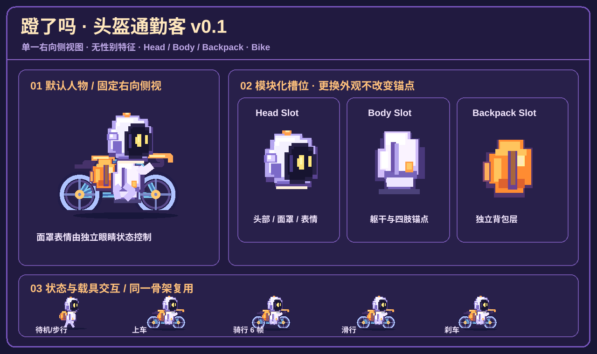

# 蹬了吗 · 默认头盔通勤客 v0.1（唯一实施基线）

> 2026-10-20 用户确认的默认角色方向。后续人物套装、载具动画和 UI 调整必须以本文件、配套角色 SVG 与 `public/riders/` Manifest 为基线；不凭旧版 Emoji/CSS 小人或万圣节装扮反推默认造型。
>
> 范围：**默认人物与自行车 / 步行最小集成**。本 PR 不修改背景图片、赛道数、预设落点、拖动协议、个人上传、Usage 数据和其他载具行为。

设计图（repo 自包含 SVG）对应实际 Slot 素材，便于维护者核对头盔、机身、橙色背包和骑车姿态。已确认的会话概念稿提供审美方向；这里的 SVG 是**按该方向新绘制的可加载原型素材**，不是从概念图自动切割出的最终像素动画帧。所有细节升级先做视觉验收，不静默改头部或体型。

> **2026-10-21 视觉纠偏（优先级最高）**：用户明确否决手工拼接的粗糙 SVG。**唯一认可的美术基线是用户提供的《抽象人物预设方向》六角色设计稿中的第 1 号「头盔通勤客」**：大奶油白圆头盔、浅紫高光、超大深紫黑面罩、暖金色发光眼睛、圆形紫色耳侧模块、橙色软包、小圆身体与短四肢，整体像素插画质感、柔软渐层、非性别化。旧 `helmet-commuter-v01-design-board.svg` 是工程占位图，**不能作为美术规范或验收对照图**。
>
> **实现变更**：运行时现在使用从用户确认设计稿中提取的透明 `atlas.webp`，按 head / body / backpack / limbs 裁剪与动画，替代手绘粗糙 SVG。旧 head/body/backpack SVG 仍留作历史工程产物，但不由 manifest 加载。自行车为单独同色系 SVG，仍需要在实际浏览器中验收人物坐姿与车轮/手脚对位。当前不是逐帧手绘精品图集，不允许未经截图验收就宣称已完全还原概念稿。

## 0. 视觉不可偏移项

- **默认 preset：头盔通勤客**，抽象、无性别特征、非人类发型/躯体；既不是男性通勤职员，也不是固定万圣节幽灵。
- **仅右向侧面**：深色圆面罩、两枚明黄色像素眼睛、奶油白/浅紫头盔与身体、橙色可替换背包；明显四肢，比例圆润，近景精细而远看轮廓简单。
- **表情由面罩小像素驱动**：正常、开心、专注、疲惫；不可回退到 Emoji 面部，也不可把额外装备烘焙进 head/body。
- **像素设计与场景分离**：角色与背景独立资产。两条万圣节道路取决于主题素材而不是角色系统；舞台在其它季节仍可按原合同显示四车道。
- 统一比例与配色，不生成大量只改变装扮但另起骨架的重复角色帧。

## 1. 资源合同（可扩展但不提前创建其它角色）

| 文件 | 职责 |
| --- | --- |
| `public/riders/manifest.json` | 默认 preset、允许试点的 transport |
| `public/riders/presets/helmet-commuter/manifest.json` | 角色逻辑画布、slot 锚点、bike 锚点、动画帧数 |
| `atlas.webp` | **当前实际加载资源**：从用户选定的 1 号角色原画提取的透明头盔、身、包、四肢像素图集 |
| `head.svg` / `body.svg` / `backpack.svg` | 旧粗糙原型，仅历史参考；**禁止作为默认视觉使用** |
| `bike.svg` | 同配色侧视自行车，独立于人物 |
| `public/rider-runtime.js` | 读取 manifest、维护三槽位、计算状态与关键帧 |
| `public/rider-runtime.css` | 画布缩放与图层，与 background/道路无关 |

渲染使用 **128 × 100 的逻辑画布**，所有 Slot 的 `x/y/width/height` 是画布坐标。统一右向、比例、头颈、背包及触地点。新套装只允许在这个合同内替换源素材，不必覆盖整个人物动画。

图层次序：地面阴影 → 自行车（若有）→ 背包 → 身体 → 头部 → 面罩表情 → 动态四肢；名字牌和 24h 留言仍是原有 DOM UI，与精灵画布分离。

## 2. 状态表

| 状态 | 逻辑帧 | 行为 |
| --- | ---: | --- |
| `idle` | 4，5 fps | 轻微呼吸/站立 |
| `walk` | 4，8 fps | 迈步摆臂，保持侧向 |
| `happy` | 3，6 fps | 面罩开心眼与挥手 |
| `focused` | 3，6 fps | 专注眼 |
| `tired` | 3，4 fps | 低头/疲惫眼 |
| `bike_mount` | 2，4 fps | 首次骑车时短暂上车 |
| `bike_ride` | 6，10 fps | 自行车踩踏循环，手保持把手锚点 |
| `bike_glide` | 2，5 fps | 固定脚位滑行 |
| `bike_brake` | 2，6 fps | 刹车姿态与轻量提示 |

以上是**逻辑 rig 动画帧**，不代表已完成 9 套独立的手绘逐帧 PNG。当前 SVG 素材 + 共享关键姿势是低成本 v0.1 验证；确认比例、场景融合和角色辨识度后，再针对上车/踩踏手脚制作更高质量的 sprite sheet，不要先批量生成所有预设素材。

## 3. 接入边界

- 在 `public/app.js` 挂载 `.pixel-rider-art`，不重写 `lanePlan`、`positionPlan`、`office_position`、权限与跨道路拖动、用户昵称、表情气泡和排行榜。
- 试点 transport 仅 `bike` 与 `walk`；滑板车、滑板、冲浪、轮滑继续用旧实现，**不冒充已经完成了其它载具动画**。
- 一次性请求静态 Manifest、共享一个动画 ticker；无每个人物自己的无限轮询。暂停标签页/尊重 `prefers-reduced-motion`。
- 素材加载失败继续显示旧人物。上传、身份与用户保存格式不变；不向公开 API 新增 appearance 字段。
- 未来新增其他预设：扩充 Catalog + Slot 素材 + 完全一致的 rig 锚点；大范围差异必须先确认造型/支点，再制作动画。
- 节日小帽、耳朵和其他装饰在后续以 accessory slot 叠加，**不是默认 helmet 的一部分**。

## 4. 验收（合并前）

1. `npm test`、`node --check public/app.js`、`node --check public/rider-runtime.js`、`node --check src/server.js`。
2. 静态请求 `/riders/manifest.json`、preset Manifest、4 张 SVG 与 `/rider-runtime.js` 均 200，内容类型正确。
3. 1440 宽 / 375 窄窗口中右向 helmet + 橙包可辨认；不出现幽灵默认装扮；简单背景与 Halloween 双赛道均正常。
4. 自行车从 mount → ride，触发 coasting/brake 后能恢复；步行有 idle/walk/happy/tired；角色点击、本人拖动和留言入口不退化。
5. 未支持载具保持原有可使用行为；动画关闭时至少可正常看见静态角色，未加载素材时退回旧渲染。
6. 页面没有越界巨大姓名牌、JS 错误、丢失的资源请求；确认再合并与上线。

## 5. 后续工作（**不在 v0.1**）

- 其他 5 类抽象预设、用户换装编辑 UI、配件槽与服装组合持久化。
- 其他 4 种可选载具的像素化：滑板车、滑板、冲浪、轮滑。
- 单独的人物/载具图集打包、最终 1:1 帧配准、多设备全量 E2E 验证。
- 根据正式背景 Manifest 提供道路安全区域 / 可选停靠点；**不为解决拥挤私自增加车道**。
