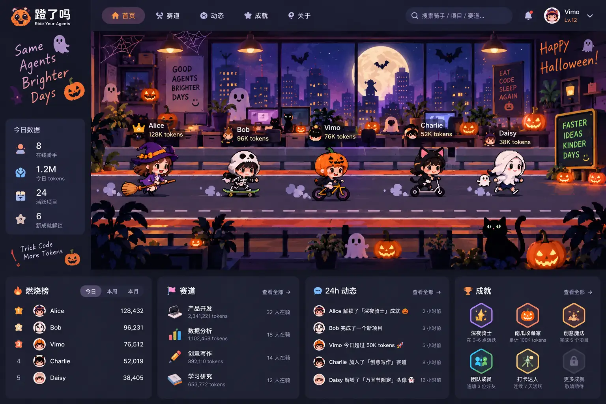
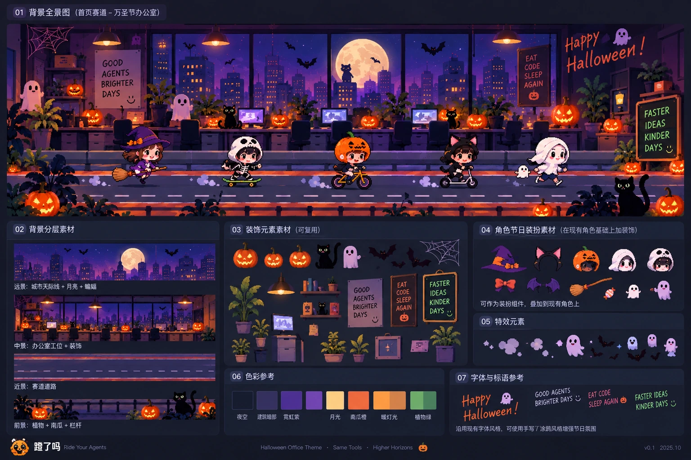

# 蹬了吗 · 万圣节分层美术与主题系统设计基线 v1

> **已确认（2026-10-19）**。开发前先读本文，开发途中有歧义以本文和用户最新确认的视觉稿为准，不可自行把背景退化成扁平 SVG。  
> 适用仓库：`viviennebla/codex-sync-server`。阶段状态：**Phase 1 已在 PR #63 修复并上线；分层素材运行时与万圣节 v2 动效已完成独立测试，待本轮 PR 合并后上线验收。真正原生 3840 高清母图仍是后续美术工作**。  
> 背景与主题设计不变更 usage、身份、installation、成就算法或上传授权。

## 0. 不可偏移的视觉参考



这张图片是用户确认的 **美术方向参考**，不是重做导航、侧边栏或四张卡片的指令。具体应保留：

- **画风**：可爱、较精致的像素风/像素插画风，高饱和紫蓝夜景、暖橙灯光与丰富层次；不要回到简单、低细节的矢量矩形/渐变画法。
- **场景**：大月亮、城市窗景、温暖的办公室、吊灯、植物、南瓜、黑猫、幽灵、适量蝙蝠。**工位纵向压缩，保留两条可用道路**。
- **交互**：当前真实 Web UI、顶部导航、左侧可透出背景的磨砂玻璃动态栏与骑手功能继续存在；不复制设计稿模拟的用户名、榜单数字和虚构数据。
- **人物**：现有 Avatar × Transport × Personality，真实数据驱动；后续才叠加节日穿戴，**不要把骑手烘焙进背景**。
- **对照**：已上线的初稿 `public/themes/halloween/halloween-two-lane-background.avif` 是可工作基线；新图要更清晰、精细、便于独立动效，而非更换构图方向。

图片原稿来自用户本轮提供的设计稿，仓库保存的是用于评审的轻量 WebP 副本（1536×1024）；不应把这张**带 UI 的参考图**用作网页背景。

### 补充：分层参考素材板（2026-10-19）



这张是用户再次确认的**素材分解方法与视觉语言参考**，不是实际已交付的透明图层，也**不是要求重做页面 UI**。后续高清出图要同时对照顶部主视觉图和本素材板：

- **01 全景**：保持紫蓝窗外城市、巨大月亮、暖色灯光和办公室纵深；参考板里的单条路仅用于氛围参考，实际首页仍是**两条赛道**。
- **02 远景／中景／近景**：沿用同一坐标系分别制作天际线与月亮、办公室本体、双道路、前景植物与栏杆。所有层必须能套同一个缩放和裁切变换。
- **03 装饰元素**：南瓜本体、黑猫、幽灵、蝙蝠、蜘蛛网、室内植物和灯具可独立维护；南瓜发光遮罩与本体分离，蝙蝠不能同时被烘焙在底图与独立层。
- **04 人物节日装扮**：帽子、猫耳、披风、南瓜头、扫帚等作为现有骑手的可选叠加件，不替换头像、交通工具或真实 usage 数据。
- **05 特效元素**：粒子、幽灵漂浮、飞越窗外的蝙蝠作为独立动效层；优先低频、轻量、可随 reduced-motion 关闭。
- **06 配色 / 07 字体与标语**：保留明亮紫色、月光金、南瓜橙与点缀植物绿。标语与字形用于气氛校准，不复制示例 UI 的组件和业务数字。

**使用边界**：此图是拼贴参考板，不能直接裁出若干矩形就称为已生成的可透明叠加素材。Phase 3 应重新制作透明图层，并检查其 alpha、配准、单独显示效果及与 3840×1440 母版的像素坐标一致性。项目设计素材不应被运行时页面加载。


## 1. 资产尺寸与坐标

| 参数 | 已确认规范 |
| --- | --- |
| 设计母版 / 统一图层画布 | **3840 × 1440 px，8:3** |
| 高清输出 | 基础图至少提供 1920w / 2560w / 3840w，按等比例生成 |
| 核心要素 | 横向两条道路，办公室占比较小；月亮/窗景不被导航遮挡 |
| 分层原点 | 全部**同一坐标画布、同一裁切 / 对齐变换**，左上角 `(0,0)` |
| 预期格式 | 母版保留无损；网页底图 AVIF（可附 WebP 兼容）；透明层 PNG/WebP；SVG 仅用于简单标识 |
| 保真要求 | 验收时实测原始图、网页压缩图在 1440/1920 宽和高 DPI 下的细节，不能仅靠低质量放大冒充新增细节 |

**裁切注意**：8:3 远宽于普通桌面视口；若整图以 `cover` 绘制在约 16:9 的舞台内，水平方向只会展示画面的约 **2/3**，因此之前建议的 `3200×1200` 不能一概视为“全屏安全区”。关键月亮及两条道路的主体验须优先在约 **中心 2400px 宽**内可见；左右装饰允许被裁，验收时根据真实 `app-shell` 尺寸微调安全框。手机必须独立验证裁切/缩放及左侧动态栏的遮挡，不强制整图全部出现在手机上。

```text
3840 × 1440 design canvas
├─ skyline + office interior      static base, no duplicated moving objects
├─ track A / track B              static road geometry
├─ lamp and pumpkin glow          transparent, registered to base positions
├─ bats-static                    transparent, removable/recolorable
├─ foreground                     transparent, z-position over/under riders as configured
└─ live rider DOM                  rendered by app.js (never baked into assets)
```

## 2. 分层资产合同

| 层 ID | 内容与边界 | 首批行为 |
| --- | --- | --- |
| `base` | 城市、月亮、办公室、桌椅、窗户、两条路和非动画主体 | 必须，静态图 |
| `glow` | 南瓜**光晕**、吊灯暖光、屏幕光；南瓜本体仍在 base/foreground，避免调亮时整图曝光 | 透明层，可渐变 `opacity`；将多灯拆为不同元素 ID |
| `bats-static` | 背景装饰蝙蝠，**不得**同时画死在 base 中 | 透明层，可隐藏 |
| `foreground` | 路边植物、栏杆、近景南瓜/黑猫/幽灵 | 透明层；不得挡住姓名、拖动热点和事件栏 |
| `bat-sprites` | 2–4 款单独的飞翔姿态，透明素材，可做飞过月亮的动画 | 首阶段只注册，不强制启用动态 |

**素材制作流程**：先做无活动角色、无蝙蝠、无光晕的干净主背景；再用一致的画布与相同坐标制作透明图层；最后按 `base → glow → bats-static → rider → foreground → flyover` 的设计顺序预合成审图。尤其要**检查 base 没有重复的固定蝙蝠和光晕**，否则关闭图层后残影仍在。若当前图片生成器无法输出精准对齐的独立透明图层，不应声称已经实现了“真分层”；可分步重绘/抠图并做叠加验收。

## 3. 轻量代码资源系统（不引入前端框架）

资源统一放在 `public/themes/halloween/`，将来其他主题可复用同一消费逻辑。建议结构：

```text
public/themes/halloween/
  manifest.json
  background/
    base-1920.avif
    base-2560.avif
    base-3840.avif
    glow.webp
    bats-static.webp
    foreground.webp
  sprites/
    bat-01.webp
    bat-02.webp
    bat-03.webp
  design/
    layer-guide.md
```

**渐进实现**：先提供当前已有资源的 `manifest.json` 和一次性轻量 theme-loader，后续素材真正生成后再新增对应文件；**不能在 manifest 中引用尚不存在的生产资源**。保持 `?season=off` / `?season=halloween`、旧版 `office-stage.svg` 的独立回退。

最小示例（仅示意字段，不是已上线文件）：

```json
{
  "id": "halloween-office-2026",
  "canvas": { "width": 3840, "height": 1440 },
  "base": { "src": "/themes/halloween/background/base-2560.avif", "width": 2560 },
  "layers": [
    { "id": "glow", "src": "/themes/halloween/background/glow.webp", "z": "above-base", "enabled": true },
    { "id": "bats-static", "src": "/themes/halloween/background/bats-static.webp", "z": "above-base", "enabled": true },
    { "id": "foreground", "src": "/themes/halloween/background/foreground.webp", "z": "above-riders", "enabled": true }
  ],
  "effects": {
    "pumpkinGlow": { "enabled": true, "periodMs": 3800 },
    "batFlyover": { "enabled": false }
  }
}
```

渲染时**同一 wrapper** 执行背景裁切/缩放变换，不能各图层分别 `cover` 导致错位。对现有静态资源白名单路由只补有限几个资源路径；不做动态开放目录或服务器数据库配置。对首屏只加载必要图层，浏览器缓存、多分辨率 `srcset`/picture 或等效资源选择，低运动偏好关闭效果。

## 4. 动效合同（先预留，后实现）

- **南瓜灯**：基础南瓜本体常驻，光晕层分别绑定 ID/锚点，不同初相位以 `opacity` 呼吸（避免布局跳动）；禁止用整张背景的 `filter:brightness` 模拟。
- **蝙蝠**：静态层独立于 `bat-sprites`；未来可按低频随机触发 1–2 只横穿窗景，优先只做 `transform/opacity`，不每名骑手创建一份。
- **视觉无障碍**：`prefers-reduced-motion: reduce` 时停止动画，但保留静态装饰；透明素材 `pointer-events:none`。
- **渲染性能**：以少量元素和压缩素材为原则，性能与清晰度同时验收；不引入 Canvas/WebGL、大型动画框架或轮询数据接口。

## 5. 当前 P1：万圣节模式拖动失效

已知：普通页面之前支持拖动**自己的**骑手，Halloween 改成两条可视道路后，用户反馈不能拖动。修复前先确认实际原因；不以“背景遮挡”作无证据结论。

调查重点：`public/app.js` 的 `attachOwnRiderDrag` / `pointerOfficePosition` / `saveDraggedRider`、`lanePlan` 的 4→2 投影；`public/halloween-theme.css` 的 `app-shell::before` / `race-stage` / lane `pointer-events`、z-index，以及左侧 glass rail 遮挡。

**必须保留**：普通版四层 lane 与旧位置合同，Halloween 仅视图映射双道路；仅本人可移动，其他同事不能被随意重置位置（若用户要求人人可拖则另行确认权限模型）。

修复验收：在**隔离的真实登录态**（不是 `?preview=1`，preview 有拖动保护）进行 `pointerdown→move→up`，双道路内位置可保存、刷新保留、换路可保存；拖动不可触发骑手详情；普通 `?season=off` 继续可拖；窄屏可触控、无误点击；不会改变其它用户的位置和生产 state。尽可能给出行为测试而非只靠静态检查。

## 6. 锁定的交付顺序与停止线

| Phase | 交付 | 停止条件 |
| --- | --- | --- |
| **0 文档** | 本设计基线及用户参考图入库 | 文档/图可打开，工程规格明确，用户可追溯 |
| **1 拖动 P1** | 诊断并修自己骑手双道路拖动，独立 fix PR | 真实登录态可保存且未破坏普通模式，**交用户验收** |
| **2 素材管理最小版** | manifest + theme loader + 资产对齐预留，独立 PR | 现有上线资源正确、回退可用；不出现不存在的资源引用 |
| **3 美术母版** | 3840×1440 高细节主图与分层素材，单独验收 | 细节优于当前 2048×768；对照视觉稿逐层验收 |
| **4 集成与动效** | 换底图、呼吸灯、蝙蝠层逐个 PR | 1440/1920/窄屏截图及流畅度验证，获用户确认再上线 |

**范围锁**：本轮不重设计 UI、不替换线上主题、不改变数据库或身份；修复拖动之后先停下验收，不在一个 PR 中顺手添加渲染系统。生产部署严格核对真正的 `denglema-dev.service :1600`、公网入口及用户数据，不能再次只看 CI 的绿色状态。

**Phase 1 实测记录（2026-10-19）**：真实隔离登录态（非 preview）复现跨 lane 重挂载会丢失 rider 上的 pointer capture。PR #63 改由不移动的 `.race-stage` 持有 capture，结束、取消和失焦后清理监听；验证 Halloween 上路→下路保存 `lane=3`、普通四车道保存 `lane=4`、375px 触摸保存 `lane=3`，拖动状态全部清理。独立测试 `npm test` 55/55 通过。**生产登录态拖动仍需上线后验证。**

## 6.1 当前落实情况：万圣节主题 v2

实现细节见 [主题 v2 资产清单](denglema-halloween-layered-v2.md)，当前正式资源入口为 `public/themes/halloween/manifest.json`，浏览器使用 `public/theme-runtime.js` 读取可用的本地资源。已经提供 `base-1920.webp`、`base-2560.webp`、`base-3840.webp` 三档背景，以及可独立调节呼吸亮度的 `glow-pumpkins.webp` / `glow-lamps.webp`、前景高光和两只透明 SVG 飞行蝙蝠。真实骑手头像、交通工具、业务数据不在背景中，头饰装扮只与稳定 user_id 相关。

**清晰度边界**：新资源修复了旧版 86 KB AVIF 的严重压缩损失；其中 3840 档是经过高质量重采样和锐化的 **2048 原始画稿衍生文件**，不得写成“原生 3840 细节已生成”。图层仍以该原画为基线，源图已烘焙的静态蝙蝠不可误称已经从 base 清除；Manifest 为新增的独立飞行蝙蝠提供开关和素材。真正完全去烘焙的高清母图和透明拆分仍待后续专门美术验收。

**行为验收**：真实隔离新用户（不是 preview）下路→上路跨 lane 拖动成功，`PUT /api/me/office-position` 为 200，返回 lane=1，刷新保留；无动效的普通主题仍显示四车道。默认万圣节双车道与 `?season=off` 可切回普通版；两档浏览器窗口与 reduced-motion 均已检查。

## 7. 来源与交接

- 视觉参考：本文顶部仓库内附图（源自用户 2026-10-19 提供的设计稿）；图上的 UI 是风格参考，不是需求范围。
- 现有工程计划历史：[`denglema-halloween-office-theme.md`](denglema-halloween-office-theme.md)，其中旧 SVG 预览只作历史记录。
- 现网基线：`public/themes/halloween/halloween-two-lane-background.avif`，主题回退 `?season=off`。下一 Chat 必须先读当前 `main`，不要继承这里的固定提交 SHA。
