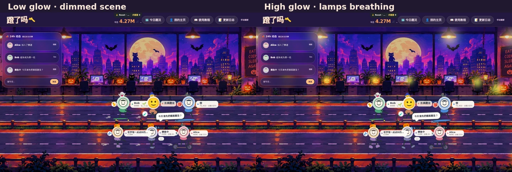

# 万圣节主题 v2：分层资源与高清导出说明

> 依照 [万圣节设计基线](denglema-halloween-layered-theme-design.md) 开发。圣诞节概念独立归档，不参与本主题的运行时代码。

## 素材来源与实际分辨率

用户确认的双赛道背景源图为 **2048×768**。本次回到高质量源文件，导出 `1920×720`、`2560×960` 与 `3840×1440` 三档 WebP，减少此前 86 KB 重压缩产生的模糊。**3840 文件是从 2048 源图经过 Lanczos 重采样与锐化得到的衍生图，不是凭空获得的 3840 原生细节**。未来获得真正高清母图时可只替换 manifest 的 base 文件，不改渲染代码。

## 层合同

1. `base`：保留当前已获用户认可的办公室与两条真实赛道，独立于骑手 DOM；本轮不改导航或数据。
2. `glow-pumpkins`、`glow-lamps`：透明 WebP 独立光晕，分别控制呼吸节奏，不修改整图亮度；使用同一 `cover` 裁剪变换。
3. `foreground-glints`：透明道路前景高光，无交互。
4. `bat-01.svg` / `bat-02.svg`：独立窗外飞行素材；保留变速 CSS 路径和 `reduced-motion`。源图当前仍画入了旧的静态蝙蝠，因此 manifest 禁止再显示同位置的第二组静态蝙蝠，避免重复。
5. 可复用头饰：保持真实头像/交通方式，按 user_id 的稳定 hash 展示女巫、南瓜、幽灵或猫耳。随机结果不受 token 消耗影响。

`manifest.json` 是唯一的资产合同入口。所有路径必须指向实际存在的本仓库静态资源；服务端使用静态 allowlist，不开放任意路径。所有视觉层须设置 `pointer-events:none`，不得覆盖自己的 rider 拖动区域。无 `?season=off` 时遵循现有秋季启用窗口；强制 `?season=halloween` 可用于节日后预览。

## 停止线与遗留

- 主题开发范围是前端视觉与资源系统，不改 `STATE_DIR`、使用量上传、Rider 身份或 office_position 数据合同。
- 当前版本清晰度主要改善是减少压缩损失和支持 Retina 请求；**重新生成原生 3840×1440 高细节美术母版**仍是设计资产的后续优化，不能冒充已经完成。
- 下次新增圣诞节/春节背景时复用选择器和层渲染机制，再制作不含人物、可分层的母图。

## v2.1 灯光对比度调整（2026-10）

图为隔离预览环境同一页面截图：左侧是谷值，右侧是峰值；用于验证分层光晕是否真的改变可见亮度，不是线上录屏。

此前南瓜光晕动画的 CSS 不透明度只有 **0.04–0.50**、吊灯 **0.08–0.32**；而两张 WebP 光晕素材非透明像素的平均 Alpha 约 **16%**，再乘动画不透明度会使峰值非常弱。更重要的是底图已绘有明亮的南瓜与吊灯，关闭光晕时灯仍发亮。

参考网页常用的 **静态暗环境层 + screen 混合的透明灯光遮罩 + 不同周期 opacity** 实现：

1. 只对 `.app-shell::before` 的**底图伪元素**使用 `filter: brightness(.81) saturate(1.12)`，不压暗骑手、UI、事件栏或发光图层。避免对整个 `.app-shell` 施加滤镜，否则连光晕一起变暗。
2. 两张本地透明光晕继续使用同源画布和 `background-size:cover`；南瓜遮罩单独提升到 `brightness(1.7)`，在 `opacity .03–.92` 间渐变；吊灯遮罩提升到 `brightness(1.5)`，在 `opacity .04–.67` 间渐变。两组动画不同周期避免同步闪烁。
3. `prefers-reduced-motion` 时停止动画，用固定中低强度光晕；所有特效维持 `pointer-events:none`，不干扰拖动。

**当前边界**：这是提升可见度的 CSS 分层增强，原始美术中已烘焙的南瓜亮部依旧存在，无法实现真正从不亮到发亮的灯芯变化；若要自然的局部熄灭/点亮，需要后续对灯芯区域做去光照底图 + 高 Alpha 发光 Mask 的精准美术重绘。此调整可以独立回滚，无用户数据迁移。
