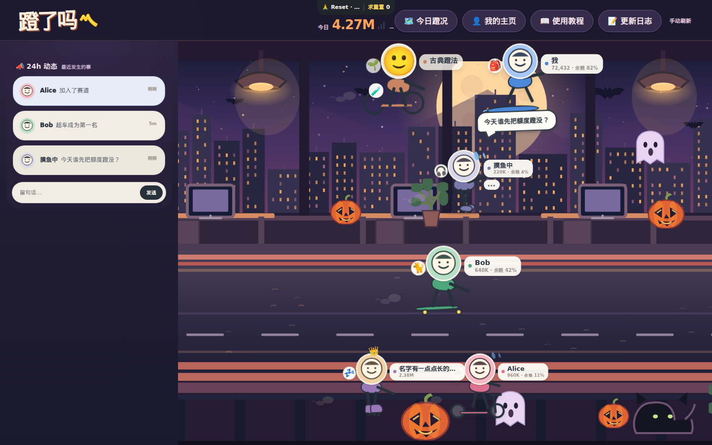

# 蹬了吗 · 万圣节办公室主题技术方案（v0）

> 状态：**阶段 A 背景已经实现并完成浏览器截图验证，等待用户视觉验收；未合并、未部署。阶段 B 特效 / 阶段 C 人物未开始。**  
> 视觉依据：2026-10-16 Project 对话中用户认可的**第二版**「万圣节办公室」设计稿。设计图是氛围参考，**不是当前页面结构的像素级改版规格**。  
> 主仓库：`viviennebla/codex-sync-server`；从当前 `main` 开发。  
> 优先级：好玩 / 易用 > 低干扰 > 数据准确 > 复杂展示；不将 token 用量包装为绩效。

## 1. 目标与边界

目标是让**现有首页**进入「万圣节夜间办公室」：紫蓝夜景、月亮与城市窗景、南瓜、蜘蛛网、幽灵和蝙蝠；已有骑手仍在原来的办公室赛场运动，增加少量帽子或披风等节日配件。

当前首页**实际结构**为：`header.topbar` + `section.race-stage`（四个 `lane`）+ 浮动 `aside.event-rail`，而非设计稿中的左侧导航栏、底部四个数据卡片与搜索栏。因此采用以下映射：

| 设计稿元素 | v0 落地方式 |
| --- | --- |
| 深紫色夜景、月亮、城市窗户、暖光 | 替换赛场背景 SVG + CSS 主题色 |
| 道路上五位可爱的万圣节骑手 | 保留真实骑手的四层定位、已有运输工具与动画，仅增加局部装扮 |
| 南瓜、蛛网、黑猫、幽灵、蝙蝠 | SVG 静态装饰优先；最多少量独立环境动效 |
| 深色导航、节日字样 | 原有 `topbar` 不重排，只做主题配色与一个短节日标记 |
| 燃烧榜 / 赛道 / 24h 动态 / 成就四卡片 | **不新增卡片**；继续沿用现有顶部导航、事件栏和已有独立页面 |

**不做**：重构成企业 Dashboard、生成五个固定人物、复活已关闭的 `.rider-workstation`、改排名/成就判定/用户数据模型、改变布局拖拽合同、引入动画框架、要求重新登录或绑定设备。

### 阶段 A：已实现的背景预览（待验收）

实际浏览器截图（临时预览服务、使用仓库内置的 6 个演示骑手，**不是原始设计稿，也不是线上已部署截图**）：

- [桌面 1440px](assets/halloween-stage-a-1440.png)
- [窄窗口 760px](assets/halloween-stage-a-760.png)
- [手机 375px](assets/halloween-stage-a-375.png)



已接入：`/?preview=1&season=halloween`；`?season=off` 或无参数恢复普通背景。独立的 `public/halloween-theme.css` 在 `styles.css` 后加载，新增加载路由仅提供 CSS 和合成 SVG。

**素材清单**（可以直接由后续阶段使用）：

| 用途 | 仓库路径 |
| --- | --- |
| 合成背景 | `public/themes/halloween/office-stage-halloween.svg` |
| 城市与月亮 | `public/themes/halloween/layers/01-city-night.svg` |
| 办公室与暖灯 | `public/themes/halloween/layers/02-office-interior.svg` |
| 道路 | `public/themes/halloween/layers/03-rider-road.svg` |
| 前景装饰 | `public/themes/halloween/layers/04-front-decorations.svg` |
| 图标集合 | `public/themes/halloween/icons/`（pumpkin、ghost、bat、black-cat、spider-web、witch-hat、broom、candle） |

主 SVG 保持固有 `1920×820` 比例，使用 `background-size: cover`，窄屏裁切而非把南瓜压扁。全部素材本地托管，不增加对第三方图片服务的运行时依赖。

**已验证**：`npm test` 55/55、`node --check`（app/server/social）、SVG XML 可解析；Chromium 1440/760/375 实际页面 6 位骑手/4 层 lane 均保留，静态资源没有 4xx；`season=off` 回到 `office-stage.svg`，旧工位继续隐藏。

**已知差异**：原页面是四层骑手场景，并非设计稿单层道路，所以上两层人物仍会出现在办公室/窗景上方；375px 时原有左侧事件区给赛场只剩约 155px，骑手拥挤明显。前者留待人物阶段决定是否调整，后者需要在发布前单独改善响应式布局；本次背景阶段没有改动交互布局。视觉稿的背景是方向标准，当前 SVG 是可复用的工程初稿，待人工审批再细调。


## 2. 现有实现与技术映射

```text
public/index.html
  ├─ header.topbar             原有入口/按钮不变
  ├─ section.race-stage        节日 SVG 背景 + 装饰层
  │   └─ #lane1 ~ #lane4       真实 rider DOM，仍按原规则定位
  └─ aside#eventRail           原有 24h 动态和留言

public/app.js
  ├─ applyTimeTheme()          已有 morning/day/evening/night
  ├─ renderRiders()            原有数据驱动的 DOM 复用
  ├─ riderMarkup()             装扮的最小插入点
  └─ updateRiderNode()         不破坏持续更新/位置/点击/拖拽

public/styles.css               现有办公室和移动端样式
public/office-stage.svg         现有 SVG 场景，维持为普通版
src/server.js                   静态资源逐项显式注册
```

主题优先由 **CSS + SVG + 极少量前端 JS** 完成，不需要新增服务端数据字段或 API。

### 2.1 场景素材

- 已准备 `public/themes/halloween/office-stage-halloween.svg`：沿用当前 `office-stage.svg` 的 `1920 × 820` 坐标体系，制作深紫色办公室外墙、窗外圆月/城市、暖黄灯、道路感地面与静态道具。
- 道路仅是**背景视觉**；不合并四个 lane、不更改 rider 的 `x/lane` 计算与碰撞边界。道路区域要与实际角色活动带对齐，不能让人物看起来漂在家具中。
- 左右边角放南瓜/蜘蛛网；中下部预留人物与姓名 chip 的安全区。主要装饰不能挡住点击、拖动、对话气泡。
- SVG 做颜色和静态形状，避免单张大位图、外部字体、第三方 CDN；优先压缩并复用路径。
- 普通版 `office-stage.svg` **保持不动**；新主题可即时关闭。新增 SVG 必须在 `src/server.js` 添加明确的 GET 静态路由，否则会返回 404。

### 2.2 主题选择与 CSS 层级

新增独立 `body.season-halloween` 类，**与**现有 `body.time-morning/day/evening/night` 共存。主题 CSS 建议集中于 `public/halloween-theme.css`，在 `styles.css` 后加载；如采用新文件，同样给服务器增加显式静态路由。

- v0 预览：`/?preview=1&season=halloween`；`?season=off` 强制普通版。保留现有 `?theme=morning|day|evening|night` 的语义。
- 默认开启时间属于产品开关：经视觉验收后，再确定是否使用北京时间 10 月下旬至 11 月 1 日的季节窗口；不要在提交设计方案时自动上线。
- 普通的白天/夜晚主题仍存在；Halloween CSS 只覆盖需要的背景、颜色和装饰，**不重复执行现有 `applyTimeTheme()`**。
- 不增加用户偏好持久化或配置 API；关闭主题恢复默认样式。默认逻辑和 URL 强制覆盖应有可测试的纯函数边界。
- 推荐主色：夜蓝紫 `#25213d`、葡萄紫 `#49305c`、南瓜橙 `#f38a38`、灯光金 `#ffd27d`、柔白 `#fff2df`；配色可以在视觉验收时微调。

### 2.3 人物与轻量节日装扮

- 保留 `riderMarkup()` 中 avatar、transport、body/arms/legs、姓名、皇冠、成就、留言、情绪标记及原有 motion。
- 第一批仅做 **2~3 种局部配饰**：女巫帽、南瓜帽/头饰、小幽灵披风；放在专门的 `halloween-accessory` 子节点上，不替换角色骨架。
- 使用 `stableHash(user_id + ":halloween")` 决定**稳定且公平**的装扮，无需额外写数据库；不能根据 token 用量决定谁穿什么，不能覆盖头像。
- CSS 配饰用 `pointer-events:none`，并检查骑行/滑板/步行/冲浪等全部 transport，不得挡住姓名、交互气泡和已有皇冠。
- `updateRiderNode()` 更新时不要反复创建装扮 DOM；人物位置变更和动态刷新后装扮保持稳定。只在 `season-halloween` 下展示，关闭即消失。

### 2.4 环境动效

第一轮以**静态场景 + 角色装扮**为主。第二轮再选做一两只缓慢飞过的蝙蝠、轻微漂浮的幽灵或南瓜光晕；使用 CSS keyframes、固定少量节点，不随着用户数线性增加。遵守 `prefers-reduced-motion` 禁用漂浮，并确保动画层不接收鼠标事件。

## 3. 建议实施顺序

| 阶段 | 提交范围 | 验收 / 停止条件 |
| --- | --- | --- |
| A — 可回退的换肤 | 节日 SVG、颜色 token、主题切换、必要静态路由 | `season=halloween/off` 互不串色；四个 lane 和事件栏不移位 |
| B — 人物节日化 | 配饰 DOM/CSS，小范围动效 | 各交通工具不变形、不遮挡点击/拖拽/留言；低运动偏好有效 |
| C — 视觉调整及上线 | 调整两种窗口宽度、配置默认启用窗口、一次性发布公告 | 人工认可真实页面；测试通过；公网入口与原数据实例均正确 |

阶段 A 完成即可给用户看 **真实代码运行截图**；未经视觉认可不扩张到设计稿的侧边栏/底部卡片。

## 4. 验收与发布

最小检查：

1. `npm test`；`node --check public/app.js`、`node --check src/server.js`，其余变更的 JS 逐个 check。
2. 桌面 1440 宽、760 附近窄窗口、375 移动端；检查 0 token、多人重叠、中文长名字、`reduced-motion`。
3. 原骑手点击、个人拖拽、留言气泡、运输工具切换、皇冠/成就与 `/api/riders` 更新均不受影响；`/me`、`/plugin` 等页面不受影响。
4. Halloween 开/关及 `theme=day/night` 组合都能正常显示，静态资源无 404；新增装饰不可遮挡交互区。
5. 不要求登录/上传/绑定方式改变，不改 `STATE_DIR`、用户记录和 usage contract，不在预览时发真实写请求。

**部署特别提醒**：之前公网入口曾误指向空数据的 `34777` 实例。正式发布前必须确认实际部署目标的 `WorkingDirectory`、`EnvironmentFile`、`STATE_DIR` 与 Tailscale Funnel 指向的是**同一套含真实用户数据的 Denglema 实例**；先记录 `/api/riders` 基线，部署后再比对，并检查主页 + `/health` + `/api/riders`，不能只看到 200 就断言部署正确。不要清理或替换任何数据目录。

发布依照仓库既有 PR → CI → runner 流程。**真正上线的代码 PR** 按 `AGENTS.md` 加一次性的 24h 公告，例如：

> 🎃 万圣节办公室上线 · 这次加班的是南瓜，不是你

失败时先关 `season-halloween`，必要时回滚相关静态资源；不用迁移和回滚用户数据。

## 5. 交接说明

- 背景实现已经在 Draft PR #56，但**尚未合并或上线**；本轮先停在阶段 A 等待人工视觉验收。
- 第二版设计稿中的左栏统计、顶部搜索、底部四卡片并非现有界面功能；本方案明确**不实现**它们，避免演变成整站重构。
- 开发前重读当前 `main` 和 `AGENTS.md`，不要依据本文固定文件行号；同一时期其他 Chat 若修改 `public/app.js` / `public/styles.css`，先合并一个 PR 再继续另一个。
