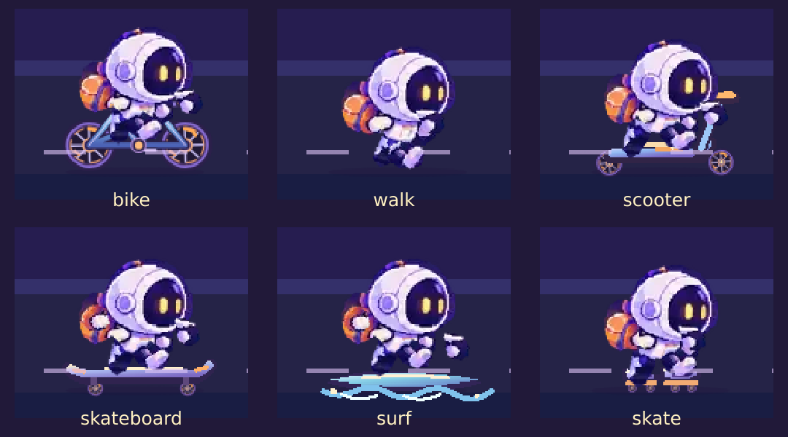

# 蹬了吗 · 六种统一像素通勤方式 v0.1

> 开发范围：统一 **赛道人物外观** 和补足滑板车/滑板/冲浪/轮滑基础动画；不改变个人头像、用户配置、使用量或路面布局。基于 #75 头盔通勤客的现有可替换部件。

## 核心约定

- 角色外观：六种 transport 都使用 `helmet-commuter`，复用同一份 head/body/backpack、四肢和 4 种表情素材。**头像是身份信息，不参与赛道角色皮肤的选择**。有头像的用户不会回退成旧 CSS 小人，个人主页、动态头像照旧。
- 载具：`bike` / `walk` 保留原有行为；新增 `scooter`、`skateboard`、`surf`、`skate` 4 张独立的可编辑 SVG。
- 结构：人物共用一个骨架和渲染 ticker，每个载具在 Rig 中仅保留逻辑画布里的尺寸、高度差及必要的**车轮图像位置**。不增加每台载具独立的手脚关节系统、不手写 atlas crop。
- 性能：小图像预加载后复用，所有人共享 ticker；标签页隐藏和 reduced-motion 时停止大部分主动运动；未引入按骑手数量持续布局/网络请求。
- 故障降级：资源加载失败时仍保留既有 CSS 人物，不能让赛道骑手完全消失；这并非头像用户的正常展示方式。

## 载具与基础循环

| Transport | 源文件 | 动作 |
| --- | --- | --- |
| 自行车 `bike` | `bike-frame.svg` + `bike-wheel.svg` | 保留 #75 原有踩踏、滑行、刹车、轮子旋转 |
| 古法步行 `walk` | 无 | 保留 #75 的交替迈腿、鞋尖方向 |
| 滑板车 `scooter` | `scooter.svg` | 双轮旋转、一只脚站板、一只脚轻踢；小幅上下浮动 |
| 滑板 `skateboard` | `skateboard.svg` | 双轮旋转、板身微摇、手臂平衡、腿小幅屈伸 |
| 冲浪 `surf` | `surf.svg` | 板身轻摆、浪花/板底一起上下浮动、手臂平衡 |
| 轮滑 `skate` | `skate.svg` | 四轮小幅转动、双腿交替向前滑步，手臂配合 |

四种新载具各具 `*_ride` 与 `*_glide` 逻辑状态，`happy/focused/tired` 继续切换独立头部表情素材。后续精细化可替换载具 SVG 或微调 Rig 的位置，不必重画人物。

## 验收入口

- [六种通勤方式的独立离线动态 HTML](previews/all-transports-animated.html)，保存后用 Chrome 打开，无需服务或登录。
- 开发服务器的 `/rider-preview` 可实时切换六种状态，同时检查小尺寸表现。
- `/?preview=1` 中有带自定义头像的演示骑手，必须 **全部** 存在 `.has-pixel-rider`，且 `.rider-inner` 不显示；头像在身份 UI 继续正常显示。
- 运行 `npm test`、`node --check public/rider-runtime.js`、`node --check public/app.js`，再做浏览器 1280/375px 实际验证。
- 新 SVG 是轻量 v0.1 可编辑原型资源，不宣称等同于未来最终逐帧手绘图集。审美通过后再进入美术精修。

**本轮不直接部署**；需要用户确认动态预览里的四种新载具姿态和整体比例。
