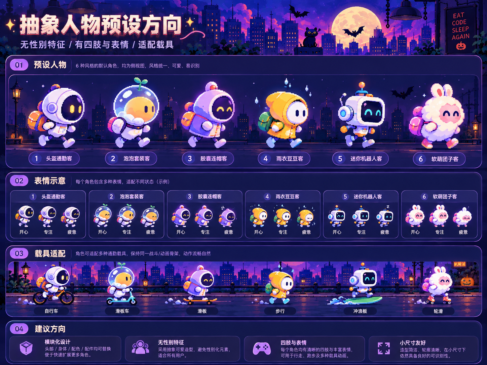

# 蹬了吗 · 已确认的人物美术母版

本目录用于**审定的角色概念设计稿**，不放临时浏览器截图、测试对照图、自动生成的候选海报或工程渲染图。

## 2026-10-22 六角色原稿

- **审定原稿**：[abstract-mascots-approved-2026-10-22.png](abstract-mascots-approved-2026-10-22.png)（用户提供，保留原始 PNG 字节，未经二次编码）。
- 源图片规格：**1448 × 1086，PNG**；原件 SHA-256：`d4186c7c642f4e72813cac075c5138a146ca5e292694877de65f799e1639849a`。
- 角色顺序：**头盔通勤客 / 泡泡套装客 / 胶囊连帽客 / 雨衣豆豆客 / 迷你机器人客 / 软萌团子客**。
- 视觉要求：一致右向侧视、无性别特征、四肢和表情、保留原稿角色轮廓与配色，可适配不同载具。
- 工程边界：原图仅是审定美术母版，并非已切好的透明 PNG 帧序列；角色素材应在 `public/riders/frames/` 下根据 Rider Pack 规则单独生产，不可直接把整张海报当角色图集裁剪并用于正式渲染。

当前最新的角色加载合同见 [Rider Pack 文档](../../denglema-character-frames-v1.md)。

## 临时图片清理规则

- 本目录仅保留用户明确确认的参考母版；未确认的 AI 候选图和临时演示图不应入库。
- 开发截图统一放 [`docs/qa/riders/`](../../qa/riders/README.md) 并保留文档引用。不能把这些历史截图误标为审定设计稿。

## 2026-10-23 工程实现

六角色设计稿继续作为权威视觉基准。除原有头盔通勤客外，`public/riders/frames/` 新增泡泡套装客、胶囊连帽客、雨衣豆豆客、迷你机器人客和软萌团子客五套原创透明 PNG 帧角色。

- 生成脚本：`scripts/generate-approved-mascot-packs.py`（基于轮廓、配色和元素重绘，不对审定海报直接裁剪）
- 所有角色均提供 walk 6 帧，bubble-suit / capsule-hoodie / mini-robot / fluffy-bun 另有 scooter / skateboard / surf / skate 各 6 帧；提供 plain/pack 与四种表情头
- 本地 `/rider-preview` 可选择全部六角色，未登记的交通方式按 Rider Pack 合同回退 walk
- Chromium 1440×900、375×812 本地验收六角色切换：PNG 均实际解码，JS error 和资源失败数为 0；`npm run riders:validate` 与 `npm test` 通过
- **美术限制**：这是原稿导向的首版工程 PNG 重绘，并非原图直接切帧或专业逐帧精绘；需进行用户最终审美验收
